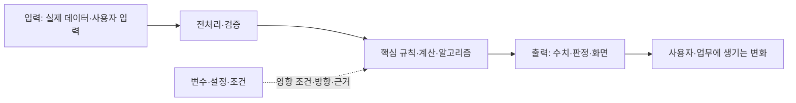

# 결과물의 핵심 구조·작동 원리·내 이해

## 사용 원칙
- 이 문서는 사용자가 결과물을 이해하고 자기 말로 설명하도록 돕는다. 빈 틀과 그림을 채우는 것이 구현·검수·이해의 증거는 아니다.
- 시작에는 1절만 적고, 핵심 흐름 첫 구현·중요한 선택·변수 검사·큰 수정·실제 사용자 설명 때 관련 부분만 갱신한다.
- 읽는 순서는 핵심 요약 → 전체 관계도 → 현재 중요한 경로의 상세 분석이다. 모든 모듈·변수·표를 한 번에 채우지 않는다. 확인·미분석 범위는 구분한다.
- 원본 E·요구 R·선택 당시 기록은 work, 실제 검사 V는 verify가 정본이다. 담당자 대화는 [Discovery.md](Discovery.md), 전후 비교는 [Compare.md](Compare.md)에 두고 여기서는 연결한다.
- 확인 사실 / 계산·추론 / 가정·제안 / 미확인을 구분한다. 실제 코드·자료·발언·관찰 위치만 연결하고 없는 구조·중간값·수치·검사를 만들지 않는다.
- 일반 기술의 정의와 현재 구현의 역할, 확인된 설계 의도와 코드를 보고 추론한 목적, 기대 효과와 실제 효과를 구분한다.
- 변경으로 설명이 낡으면 영향받는 부분을 재확인 필요로 표시한다. 사용자 설명이 없으면 이해 상태는 미확인이다.
- 문서·AI 사용과 기록 보관은 현재 과제·단계의 허용 범위를 따른다. 채워진 문서를 외부로 전송하지 않는다.

## 1. 먼저 보는 핵심
각 항목을 한두 문장으로 시작하고 상세 위치를 연결한다.
- 누구의 어떤 문제 / 요구 R·근거 E:
- 성공 조건·필수 결과물 / 현재 완료 범위:
- 결과물의 근간·핵심 입력 → 처리 → 출력:
- 담당자에게 확인한 문제·기준 / Discovery 위치:
- 중요한 선택과 이유 / work 결정·Compare 위치:
- 결과를 바꾸는 변수·조건 / 5절:
- 실제 검사 범위·V / 미확인·한계:
- 사용자가 설명해 본 범위 / 7절:
- 마지막 확인한 코드·자료·규칙 상태 / 재확인할 부분:

## 2. 기반과 전체 관계도

| 구분 | 실제 방식·역할 | 원본 위치·E | 확인 상태·한계 |
|---|---|---|---|
| 업무 목적·기준 | | | 미확인 |
| 언어·프레임워크·실행 환경 | | | 미확인 |
| 데이터 출처·읽기·저장 | | | 미확인 |
| 핵심 알고리즘·계산·규칙 | | | 미확인 |

프레임워크와 업무 알고리즘을 구분한다. 실제 없는 서버·DB·AI 호출을 추가하지 않는다. 분석·문서 과제는 자료→처리→결론으로 바꿔 사용한다.

다음은 작성용 틀이다. 확인한 실제 단계·이름으로 바꾸고 없는 단계를 지운다.

터미널에서는 아래 일반 텍스트 관계도를 기본으로 작성한다. 실제 단계·이름으로 교체하고 없는 단계는 삭제한다. 관계별 예상·관찰·미확인과 위치를 연결한다.

```text
[원본·사용자 입력] -> [범위·품질 확인] -> [핵심 처리] -> [출력·판정]
                                           ^
                                   [설정·규칙·조건]

변수 변경 -> 영향을 받는 처리·중간값 -> 결과 변화
성립 조건 / 유지할 조건 / 예상 또는 실제 관찰 / E·V·위치:
```

다음 Mermaid는 선택 사항이다. 렌더링 가능 여부를 확인하지 않았다면 그림이 보인다고 보장하지 않는다.



- 실선은 처리·데이터 연결, 점선은 변수·조건의 영향 관계다. 선 모양은 검증 수준을 뜻하지 않는다.
- 중요한 관계마다 코드 근거 / 규칙상 예상 / 실행 관찰 / 미확인과 E·V 또는 위치를 붙인다.
- 증가·감소·유지·조건부·방향 미확인을 구분한다. 분기·상호작용을 표시하고, 그림의 연결만으로 인과관계를 입증했다고 하지 않는다.
- 업무 문제·요구 R → 담당 모듈·변수 → 결과·지표 → 실제 검사 V를 연결한다. 담당자 발언과 검증 사실을 구분한다.
- 표시만 바뀐 것과 계산·판정이 달라진 것을 구분한다. 복잡하면 전체 흐름과 중요한 경로로 나눈다.

텍스트 대체: **무엇을 변경 → 어느 처리·중간값이 왜 달라짐 → 어떤 결과 / 성립 조건 / 근거·확인 상태.**

학습용 계산 예시: 고정 점수 [60,75,90]에서 점수 > 임계값으로 선택한다면, 임계값 70→80 → 선택 [75,90]→[90] → 건수 2→1이다. 원본 3건은 유지된다. 이는 설명용 계산이며 실제 서비스 실행이나 품질 개선의 증거가 아니다.

## 3. 모듈·스텝의 정의·목적·의의와 상세 분석

### 먼저 범위를 정하기
| 실제 모듈·위치·호출 연결 | 한 문장 역할 | 확인한 범위·아직 분석하지 않은 범위 | 상세 기록 위치 |
|---|---|---|---|
| | | 미확인 | |

중요한 경로부터 분석한다. 상세 설명은 아래 카드와 단계표 중 적합한 곳을 선택하고, 같은 내용을 다시 쓰지 않는다. 모듈과 내부 단계의 경계를 실제 구현에 맞춘다.

### 모듈 정의 카드
필요한 모듈마다 사용하며, 이미 표에 적힌 값은 위치를 연결한다.
- **정의:** 무엇인가? 필요한 전문용어를 풀어 설명:
- **책임·경계:** 맡은 일과 다른 모듈·외부 의존성이 맡은 일:
- **동작:** 입력·형식·단위·조건 → 핵심 처리 → 출력·상태 변경:
- **목적:** 어떤 요구 R·업무 문제 때문에 필요한가? 확인된 결정·담당자 근거:
- **의의:** 다음 단계·최종 결과의 어떤 성질에 어떻게 기여하는가? 예상과 실제 효과 구분:
- **실패·생략 영향:** 바뀌는 경로와 조건 / 실제 관찰 또는 추론:
- **근거:** 실제 파일·함수·자료 위치·버전·E·V / 남은 미확인:

### 스텝별 상세 표
| 실제 순서·조건·위치 | 정의·입력 | 처리·규칙·출력 | 목적·전체 결과에서의 의의 | 연결·상태·실패·경계 | 근거·확인 범위 |
|---|---|---|---|---|---|
| | | | | | 미확인 |

실제 흐름이 분기·병렬·반복이면 그 조건을 표시한다. 파일 이름만으로 역할을 단정하거나 하나의 함수가 실제로 여러 모듈로 나뉘어 있다고 설명하지 않는다.

### 중요한 경로 확대도
실제 분석 후 채우는 틀이며, 위 표와 노드 이름·연결을 일치시킨다.


렌더링이 안 되면 번호·화살표 문장으로 같은 내용을 남긴다.

### 작은 입력 추적
| 단계·위치 | 입력값·형태 | 규칙·계산 | 출력값·형태 | 예상 / 실제 관찰·근거 |
|---|---|---|---|---|
| | | | | |

필요한 조사만 수행한다.
1. 현재 구현·원본·호출 관계에서 실제 동작을 먼저 확인한다. 목적은 요구·선택 당시 기록과 대조한다. 코드를 보고 추론한 의도는 추론으로 둔다.
2. 용어·기술 정의가 불명확하면 허용된 범위에서 해당 버전의 공식 문서 등 1차 자료를 읽고 출처·절·버전·확인 시점을 남긴다. 일반 문서의 기능이 현재 구현에서 사용됐다고 자동 판단하지 않는다.
3. 데이터의 형태·키·단위·누락 처리, 실제 존재하는 저장·캐시·비동기·재실행 상태, 오류 전달과 입력 규모의 영향을 필요한 만큼 확인한다.
4. 출력만 보고 내부 중간값을 관찰했다고 쓰지 않는다. 실제 자료와 설명용 입력을 구분한다. 성능·복잡도 추론과 측정 결과도 구분한다.
5. 생략·실패 영향을 보기 위해 운영 기능을 무작정 제거하지 않는다. 필요한 비교·검사는 허용된 환경에서 수행하고 verify에 연결한다.

## 4. 중요한 선택
- 무엇을 선택했나 / 관련 요구·구현 위치:
- 선택 당시 관찰한 문제·근거 / work 결정 위치:
- 실제 고려한 대안·선택 이유·감수한 점:
- 실제 비교·검증 범위 / V:
- 사후에 학습한 대안·설명 / 당시 판단과 구분:
- 다시 선택을 검토할 조건 / 미확인:

상세한 Original 대비 차이·장단·전환 조건은 Compare에 두고 여기서는 현재 구조를 이해하는 이유만 연결한다. 기존 방식이 없으면 신규 선택이라고 적는다.

## 5. 변수 변경과 결과의 관계

| 변수·위치·종류·단위 | 현재값·근거 → 변경값·유효 범위 | 영향 경로·예상 결과·성립 조건 | 실제 결과·V·대상 상태 | 유지할 조건·한계 |
|---|---|---|---|---|
| | | | 미실행 | |

- 사용자 입력 / 설정·규칙 / 계산된 중간값을 구분한다. 직접 바꿀 수 없는 값은 어떤 입력·처리로 달라지는지 설명한다.
- 변경 전후의 입력·중간값·출력과 증가·감소·유지·조건부 관계를 기록한다. 조건·경계·다른 변수와의 상호작용을 밝힌다.
- 실행 전에 독립 근거로 예상하고 가능한 범위에서 다른 조건을 유지해 비교한다. 동시에 바뀐 조건과 무작위성은 한계로 남긴다.
- 예상과 실제가 다르면 원인을 확인하고 설명·그림·관련 검사를 갱신한다. 실제 검사를 안 했으면 예상으로만 둔다.
- 필수 검수·결과물·제출 시간을 우선하며 설명용 실험은 필요한 만큼만 한다.

## 6. 애매한 주장과 놓치면 안 되는 조건
| 주장·용어 | 구체적인 의미·대상·조건 | 근거·V | 예외·미확인 | 필요한 설명·다음 확인 |
|---|---|---|---|---|
| | | | | |

“최적·정확·실시간·개선·자동·완료”처럼 범위가 큰 표현은 비교 기준·조건·관찰 범위를 확인한다. 쓰지 않은 표현의 항목을 억지로 만들지 않는다.

## 7. 사용자가 이해했는지 확인
허용된 단계에서 중요한 주제 하나씩 사용자가 먼저 설명·예측하게 하고 근거와 대조한다. 미응답이면 미확인으로 두고 가능한 본작업은 계속한다.

질문 축: 입력→출력 / 모듈의 정의·목적·의의 / 선택 이유·다른 선택이 나은 조건 / 변수 영향·유지 조건 / 실제 검사·미확인.

| 주제 | 실제 사용자 설명·예측 | 근거상 정확한 점·보완점 | 필요한 재설명·직접 확인 | 이해 상태 |
|---|---|---|---|---|
| | 사용자 답변 없음 | | | 미확인 |

상태: 미확인 / 보완 필요 / 해당 질문에서 설명 확인 / 변경 후 재확인 필요.
AI가 답을 대필한 것을 사용자 이해로 기록하지 않고, 한 질문의 설명 확인을 전체 이해나 실행 성공으로 확대하지 않는다.

## 8. 마무리 설명
실제 기록으로만 말한다.
> ___ 문제를 해결하기 위해 ___ 입력을 ___ 모듈과 ___ 방식으로 처리한다. ___ 근거로 선택했고 ___를 감수한다. ___ 변수를 바꾸면 ___ 조건에서 ___ 결과가 예상되며 실제 확인은 ___까지 했다. 아직 ___는 모른다.

검증된 핵심만 summary에 연결한다. 문서 작성·설명 연습만으로 과제 완료를 선언하지 않는다.

### AI 답변을 사용자가 확인하는 짧은 절차
중요한 주장에만 적용하고 상세 검사 결과는 verify에 둔다.
1. “좋아졌다”를 지표·대상·비교 조건이 있는 주장으로 바꾼다.
2. 대표 입력 한 건의 원본→중간 계산·판정→출력을 따라간다. 전체 검사의 대체 표본으로 확대하지 않는다.
3. 업무상 필수 제약은 점수·평균 개선과 분리해 검사한다. 무효 배치의 낮은 점수를 성공으로 쓰지 않는다.
4. 관련 변수 하나를 바꾸기 전에 사용자의 예측을 받고 다른 조건을 고정해 실제 결과와 대조한다. 실제 응답은 7절, 실행 결과는 verify.
5. 좋아진 지표와 그대로이거나 악화된 지표를 함께 본다. 작업량·완료 시각·준수 건수·가중 점수는 다른 지표일 수 있다.
6. 실행 명령·입력·기대·실제·근거 위치·미실행 범위를 받는다. “다시 검토했다”는 문장만으로 확인 완료로 삼지 않는다.
